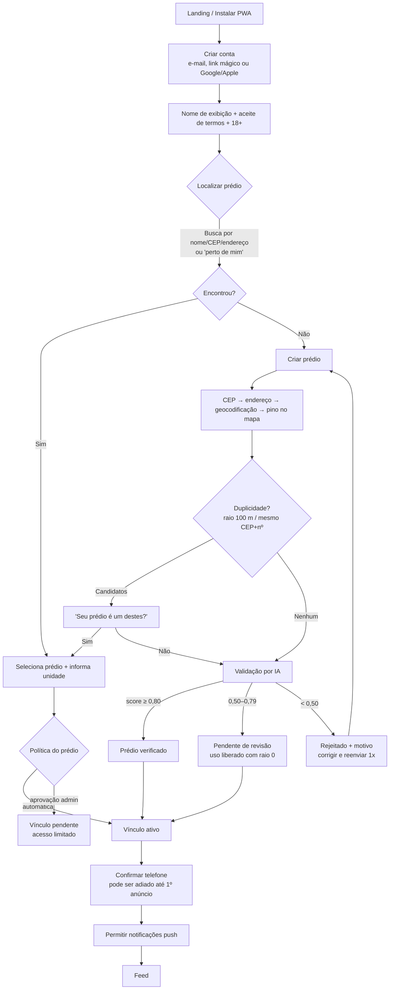
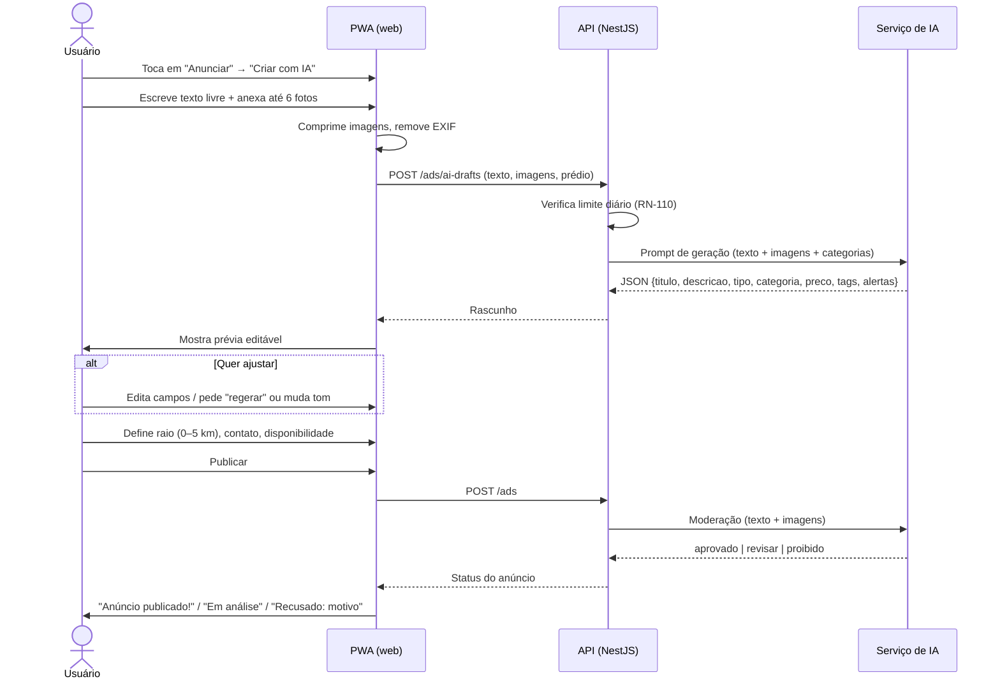

# 3. Fluxos do Usuário

## 3.1 Cadastro e onboarding

Estados do usuário: `onboarding_pendente` → `ativo` (com pelo menos um vínculo ativo ou pendente em prédio não rejeitado) → `suspenso` / `banido` / `excluido`.

## 3.2 Criação de anúncio com IA

## 3.3 Criação de anúncio manual

1. "Anunciar" → "Criar manualmente".
2. Preenche campos (RN-052). Botão opcional **"Melhorar texto com IA"** (RN-055).
3. Escolhe raio e contato → Publicar → moderação (RN-062).

## 3.4 Consumo (feed → contato)

1. Feed com anúncios visíveis (RN-058) ordenados (RN-071).
2. Filtra/busca → abre o anúncio (fotos, descrição, preço, prédio de origem, distância, selo, perfil do anunciante).
3. Ações: **Conversar** (chat interno), **WhatsApp** (se habilitado), **Favoritar**, **Compartilhar** (link que exige login), **Denunciar**.

## 3.5 Administrador do prédio

*(Removido em 17/10/2026.)* Prédios não têm administrador: o vizinho entra na hora (RN-037) e a moderação é da IA e da plataforma (3.6).

## 3.6 Admin da plataforma (painel)

- Fila de prédios `pendente_revisao` com o relatório da IA (score, justificativa, evidências, mapa, foto).
- Fila de anúncios `em_moderacao` e denúncias.
- Gestão de usuários (suspender, banir, histórico de infrações).
- Configurações (limites, raios, categorias, thresholds de IA).
- Métricas: prédios, usuários ativos, anúncios por categoria, uso/custo de IA.
