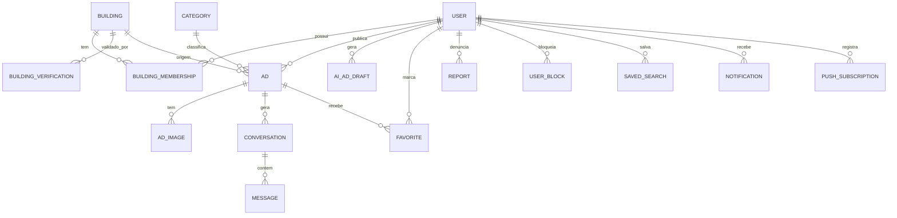

# 5. Modelo de Dados

Banco sugerido: **PostgreSQL + PostGIS** (consultas por raio com `ST_DWithin` sobre `geography`). Todas as tabelas têm `id` (UUID), `created_at` e `updated_at`.

## 5.1 Diagrama



## 5.2 Entidades

### `users`
| Campo | Tipo | Observação |
|-------|------|-----------|
| email | text, único | |
| phone | text, único, nulo | E.164 |
| phone_verified_at | timestamptz, nulo | RN-002 |
| display_name | text | |
| username | text, único, nulo | RN-010; nulo só até o passo de perfil |
| avatar_url | text, nulo | |
| status | enum | `onboarding_pendente`, `ativo`, `suspenso`, `banido`, `excluido` |
| suspended_until | timestamptz, nulo | RN-095 |
| primary_building_id | FK buildings, nulo | RN-035 |
| role | enum | `user`, `platform_admin` |
| plan | enum | `free`, `pro` — cópia do estado da assinatura (RN-140) |
| terms_accepted_at | timestamptz | |
| notification_prefs | jsonb | RN-122 |

### `buildings`
| Campo | Tipo | Observação |
|-------|------|-----------|
| name | text | |
| type | enum | `edificio`, `condominio_horizontal` |
| cep, street, number, district, city, state | text | |
| location | geography(Point, 4326) | índice GIST |
| units_estimate | int, nulo | |
| facade_photo_url | text, nulo | |
| status | enum | `pendente_validacao`, `verificado`, `pendente_revisao`, `rejeitado`, `arquivado` |
| created_by | FK users | |
| resubmissions | int | RN-029 |
| last_activity_at | timestamptz | RN-033 |

### `building_memberships`
| Campo | Tipo | Observação |
|-------|------|-----------|
| user_id / building_id | FK | único por par |
| unit | text | privado (RN-007) |
| status | enum | `pendente`, `ativo`, `recusado`, `removido` |
| verified_at | timestamptz, nulo | selo (RN-038) |
| verified_method | enum, nulo | `admin`, `vizinhos`, `comprovante` |

### `building_verifications`
| Campo | Tipo | Observação |
|-------|------|-----------|
| building_id | FK | |
| input | jsonb | dados enviados + evidências |
| output | jsonb | resposta da IA |
| score | numeric(3,2) | |
| decision | enum | `verificado`, `pendente_revisao`, `rejeitado` |
| decided_by | enum | `ia`, `admin` |
| reviewer_id | FK users, nulo | |
| model, prompt_version | text | auditoria |

### `categories`
`name`, `slug`, `icon`, `sort_order`, `active`.

### `ads`
| Campo | Tipo | Observação |
|-------|------|-----------|
| user_id | FK | |
| building_id | FK | prédio de origem |
| type | enum | `servico`, `produto`, `procura` |
| category_id | FK | |
| title, description | text | |
| price_mode | enum | `fixo`, `a_partir_de`, `a_combinar`, `gratuito` |
| price_cents | int, nulo | |
| radius_m | int | 0, 500, 1000, 2000, 3000, 5000 |
| location | geography(Point) | cópia do prédio de origem (desnormalizado p/ consulta) |
| whatsapp_enabled | bool | |
| availability | text, nulo | `todos_os_dias`, `dias_uteis`, `fins_de_semana`, `horario_comercial`, `noites`, `a_combinar` (RN-052) |
| tags | text[] | |
| status | enum | RN-061 |
| featured_at | timestamptz, nulo | destaque do plano Pro (RN-144) |
| ai_generated | bool | métrica |
| expires_at | timestamptz | RN-063 |
| bumped_at | timestamptz, nulo | RN-067 |
| search_vector | tsvector | busca textual (português) |

### `ad_images`
`ad_id`, `url`, `thumb_url`, `position`, `width`, `height`, `moderation_status`.

### `ai_ad_drafts`
`user_id`, `input_text`, `input_image_urls`, `tone`, `output` (jsonb), `ad_id` (nulo até publicar), `tokens_in`, `tokens_out`, `model`, `prompt_version`. Usado também para o limite diário (RN-110).

### `conversations` / `messages`
- `conversations`: `ad_id`, `buyer_id`, `seller_id`, `last_message_at`, `status` (`aberta`, `bloqueada`). Único por (`ad_id`, `buyer_id`).
- `messages`: `conversation_id`, `sender_id`, `body`, `image_url`, `read_at`, `flagged`.

### Demais
- `favorites`: `user_id`, `ad_id` (único por par).
- `user_blocks`: `blocker_id`, `blocked_id`.
- `reports`: `reporter_id`, `target_type` (`ad`, `user`, `message`, `building`), `target_id`, `reason`, `details`, `status` (`aberta`, `procedente`, `improcedente`), `resolved_by`.
- `sanctions`: `user_id`, `type` (`aviso`, `suspensao`, `banimento`), `reason`, `ends_at`, `appeal_status`.
- `saved_searches`: `user_id`, `building_id`, `filters` (jsonb), `notify`.
- `notifications`: `user_id`, `type`, `payload`, `read_at`.
- `push_subscriptions`: `user_id`, `endpoint`, `p256dh`, `auth`, `user_agent`.
- `settings`: chave/valor para todos os itens `[configurável]`.

## 5.3 Consulta de visibilidade (RN-058)

```sql
-- Anúncios visíveis para o prédio :building_id
SELECT a.*,
       ST_Distance(a.location, b.location) AS distance_m
FROM ads a
JOIN buildings b ON b.id = :building_id
WHERE a.status = 'ativo'
  AND a.user_id <> :viewer_id
  AND (
        a.building_id = b.id
        OR ST_DWithin(a.location, b.location, a.radius_m)
      )
  AND NOT EXISTS (SELECT 1 FROM user_blocks ub
                  WHERE (ub.blocker_id = :viewer_id AND ub.blocked_id = a.user_id)
                     OR (ub.blocker_id = a.user_id AND ub.blocked_id = :viewer_id))
ORDER BY (a.building_id = b.id) DESC,
         distance_m ASC,
         COALESCE(a.bumped_at, a.created_at) DESC;
```

> Para performance, pré-filtrar com `ST_DWithin(a.location, b.location, 5000)` (raio máximo global) usando o índice GIST antes de aplicar o raio de cada anúncio.

### `subscriptions`
| Campo | Tipo | Observação |
|-------|------|-----------|
| user_id | PK, FK users | uma linha por usuário |
| stripe_customer_id | text, único | cliente no Stripe |
| stripe_subscription_id | text, único, nulo | assinatura atual |
| status | text, nulo | status do Stripe (`active`, `past_due`, `canceled`…) |
| current_period_end | timestamptz, nulo | fim do período pago |
| cancel_at_period_end | bool | cancelamento agendado |

### `ad_recommendations`
| Campo | Tipo | Observação |
|-------|------|-----------|
| ad_id, user_id | PK composta | uma indicação por pessoa por anúncio (RN-086) |
| created_at | timestamptz | |

### `user_reviews`
| Campo | Tipo | Observação |
|-------|------|-----------|
| reviewer_id, reviewed_id | FK users, únicos juntos | uma avaliação por par (RN-087) |
| ad_id | FK ads, nulo | anúncio da conversa que liberou a avaliação |
| rating | smallint | 1 a 5 |
| comment | text, nulo | até 500 caracteres |

